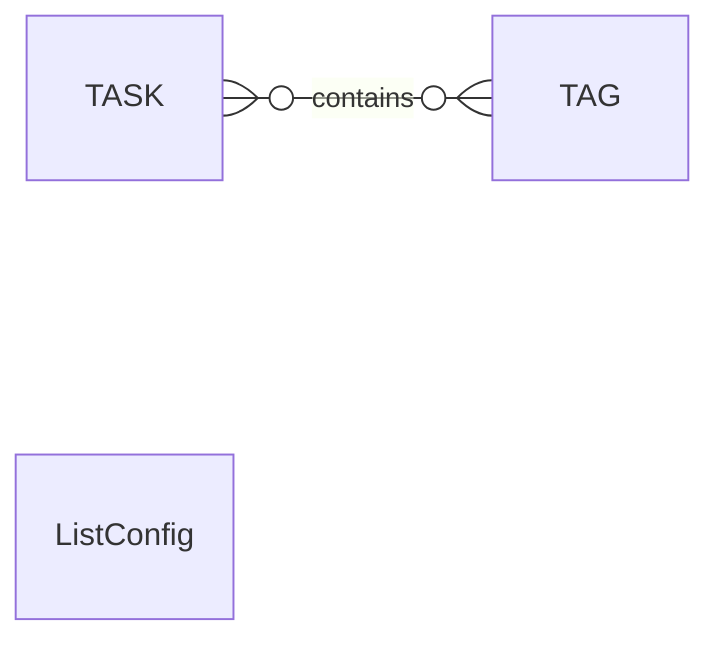
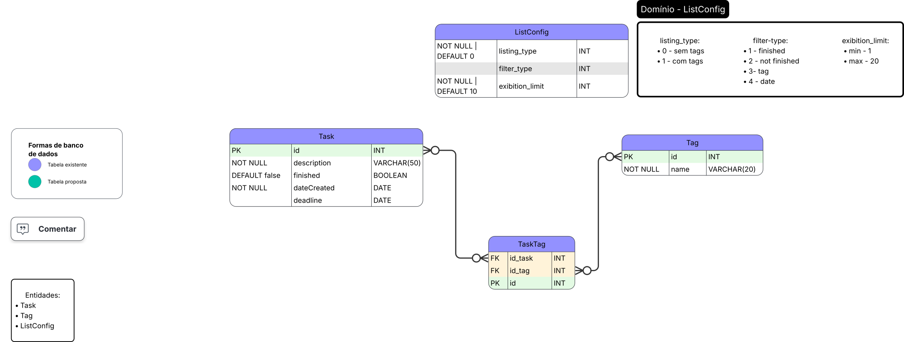

# Domínio

Este documento tem como objetivo documentar o domínio dos atributos do Diagrama de Entidade e Relacionamento

## Diagrama Conceitual

## Diagrama Lógico

## Domínio

### ListConfig

#### listing_type

Define o estilo de listagem da lista inicial.

Possue apenas dois valores possíveis:

- 0 - a listagem não mostrará as tags das tarefas (RF-016)
- 1 - a listagem mostrará as tags das tarefas (RF-017)

#### filter-type

Define o filtro que estará na lista inicial, podendo não ter filtro.

Possue apenas os seguintes valores:

- 1 - filtra as tarefas finalizadas (RF-011)
- 2 - filtra as tarefas que não foram finalizadas (RF-012)
- 3 - filtra as tarefas por **uma** tag (RF-013)
- 4 - filtra as tarefas por um período de tempo (RF-014)

#### exibition_limit

(RF-031)

Define o limite de tarefas que serão mostradas na lista inicial.

Este atributo possui um range de valor:

- Min - 1
- Max - 20

Sendo o valor padrão: 10
